# SD Voice Town Hall

**Report a street problem in San Diego by talking. The map works out where it is.**

Residents call an ElevenLabs voice agent and describe what's wrong and what's nearby ("a huge pothole at 7th and Market, by the parking garage"). There's no app, no account and no GPS. The backend classifies the report into one of the City's 23 *Get It Done* categories and turns the landmarks into a location with an honest uncertainty radius. It merges repeat reports of the same problem, so every extra caller tightens the pin. City staff see it all live on a map with a review queue for safety hazards.

Built for UN SDGs 10 (reduced inequalities), 11 (sustainable cities) and 16 (strong institutions).

## How a call becomes a pin



1. **Call.** The caller talks to the ElevenLabs agent from the live map's call button. A live transcript shows both sides of the conversation.
2. **File.** As soon as the agent has a problem and any location clue, it runs the `submit_report` tool, which posts to the backend.
3. **Classify + locate.** Keywords map the report to a Get It Done category and urgency tier. Cross streets and landmarks are matched against about 80 San Diego intersections, landmarks and streets, with OpenStreetMap as a fallback. The radius follows from the match: about 50 m for an intersection, 150–400 m for a landmark, 1 km for a street or neighborhood.
4. **Merge or create.** If an open issue in the same category is within 800 m, the call is merged into it. The call count goes up, the pin moves toward the better-located report, and the radius **shrinks at least 40%**. Otherwise a new issue is created.
5. **Review.** New Tier 1 safety hazards wait in the review queue until a person clicks **Approve for crew**.
6. **Verify + decay.** Anyone can vote "still there / gone", and three "gone" votes resolve an issue. **Simulate 2 weeks** fast-forwards time with no new calls: quiet issues drop a tier, routine ones resolve on their own, and safety hazards are held.

**Edge cases the pipeline handles:**

- **Caller in a rush:** the report is saved as a *preliminary draft* (dashed, 1 km radius) and the agent reads out a 3-digit PIN.
- **Caller returns with the PIN:** the draft reopens and snaps to a 60 m pinpoint.
- **Caller hangs up mid-call:** the browser sends whatever was said, including the agent's read-backs. If there's a problem type and a location, the report is plotted with a wide 800 m radius.
- **Same call reported twice** (in-call tool and post-call webhook): deduplicated by `conversation_id`.

## Urgency tiers

| Tier | Meaning | Color | Examples |
|---|---|---|---|
| 1 | Safety hazard (respond within hours) | 🟥 Red `#b42318` | Dark traffic signal, tree down, street flooding, car blocking a hydrant |
| 2 | High urgency (1–3 days) | 🟧 Orange `#e8650f` | Pothole, street light out, illegal dumping, encampment, sidewalk trip hazard |
| 3 | Medium (days to 2 weeks) | 🟨 Amber `#f6b93b` | Missed collection, overgrown vegetation, signal timing, parks |
| 4 | Low / routine | 🟡 Yellow `#f9e36a` | 72-hour parking, street sweeping, graffiti |

## The dashboard

**Presenting it?** See [docs/DEMO_NOTES.md](docs/DEMO_NOTES.md): a tour of every tool on the map, a 3-minute demo flow, how the 2-week decay works, and technical notes for Q&A.


- **Landing page** (`/`) explains the idea.
- **Live map** (`/map`):
  - **Urgency pins** with uncertainty halos, or a **call heatmap**.
  - **Category filters:** Roads & Signals, Sanitation & Dumping, Lighting & Parks, Preliminary Drafts.
  - **Simulate 2 weeks** button.
- **Sidebar:**
  - The **call button**, with a live caller/agent transcript and a line showing how the report was filed.
  - Headline stats and the **Needs review** queue.
  - **Hotspots** (the most-called issue per field) and recent calls.
  - **Reset** back to the 35 seeded issues.

## Run it locally

```bash
npm install
npm run build        # installs + builds the dashboard (frontend/) into frontend/dist
npm start            # http://localhost:3000: API + dashboard on one port
```

For hot reload, run `npm run dev:server` and `npm run dev:client` in two terminals, then open http://localhost:5173. Vite forwards `/api` to port 3000.

**Voice calls:** create the agent using [agent/ELEVENLABS_SETUP.md](agent/ELEVENLABS_SETUP.md). Put its id in `frontend/.env` as `VITE_ELEVENLABS_AGENT_ID=agent_…`, then rebuild. The id is baked in at build time. If the backend isn't running, the dashboard falls back to in-browser demo data (`data/issues.json`) with scripted sample calls.

**Data:** the server stores issues in `server/data/issues.json`, created from `server/seed.js` (35 seeded calls around Downtown, North Park, Mission Valley and Pacific Beach). **Reset** in the sidebar, or `POST /api/reset`, restores it.

## Deploy to Daytona (one command)

1. Create an API key at **app.daytona.io → API Keys**, copy `.env.example` to `.env`, and set `DAYTONA_API_KEY`.
2. Make sure `frontend/.env` has your `VITE_ELEVENLABS_AGENT_ID`.
3. Run:
   ```bash
   npm run deploy:daytona
   ```
   This creates a **public** sandbox with auto-stop off, uploads the code, builds, starts the server on port 3000 and prints the public URL. The sandbox id is saved to `.daytona-sandbox`, so re-running redeploys to the same URL.
4. Add the printed hostname to the ElevenLabs agent's **allowlist**.

**Options:**

- `RESET_DATA=1` restores the seeded issues.
- `FRESH=1` creates a new sandbox.
- `CASE_SANDBOXES=1` turns on per-case sandboxes (below).
- `ELEVENLABS_WEBHOOK_SECRET` is passed to the server for the signed post-call webhook.

### Per-case Daytona sandboxes (optional)

With `DAYTONA_API_KEY` set on the server (`CASE_SANDBOXES=1` when deploying), every live case gets its own Daytona sandbox (`server/sandbox.js`):

- **Opened** in the background when a case goes live: a new report, a PIN-reopened draft, or a merge into a case without one. Its details go into `case.json`.
- **Deleted** when the case resolves, and on reset.
- **Cleaned up:** sandboxes are ephemeral, auto-delete after `DAYTONA_IDLE_MINUTES` idle (default 60), and a sweep removes leftovers every 15 minutes.

The hosting sandbox is labelled `sd-voice-town-hall-host`, so the sweep never touches it. Without a key, all of this is a no-op.

## API

| Method | Path | What it does |
|---|---|---|
| `POST` | `/api/tools/submit-report` | File a report (the agent's tool, the hang-up fallback, tests). Returns `{ action, issue_id, pin_code, message }`; the agent speaks `message` |
| `POST` | `/api/webhook/voice-report` | ElevenLabs post-call webhook (HMAC-checked when `ELEVENLABS_WEBHOOK_SECRET` is set) |
| `GET` | `/api/issues` | Open issues (`?all=1` includes resolved) |
| `POST` | `/api/issues/:id/verify` | `{ "still_there": true \| false }`; 3 × false resolves it |
| `POST` | `/api/issues/:id/approve` | Approve a flagged hazard and forward it to the crew |
| `POST` | `/api/simulate-decay` | Two weeks of silence; returns `{ downgraded, resolved, held, resolved_issues }` |
| `POST` | `/api/reset` | Restore the 35 seeded issues |
| `GET` | `/api/summary`, `/api/feed`, `/api/stream` | Executive summary, recent pipeline events, live updates (server-sent events) |

Quick test:

```bash
curl -X POST localhost:3000/api/tools/submit-report -H 'Content-Type: application/json' \
  -d '{"transcript":"another huge pothole at 7th and Market"}'
```

## Repo layout

| Path | What's there |
|---|---|
| `frontend/` | The dashboard: React 19, Vite, Tailwind v4, Leaflet + `leaflet.heat`, ElevenLabs React SDK |
| `server/index.js` | Express routes, live update stream, serves `frontend/dist` |
| `server/pipeline.js` | PIN drafts, hang-up handling, 800 m merge with radius shrinking, Tier 1 flagging, decay |
| `server/categories.js` | The 23 Get It Done categories, tiers and keyword classifier |
| `server/geocode.js` | San Diego landmark, intersection and street lookup, with Nominatim as a fallback |
| `server/sandbox.js` | Per-case Daytona sandboxes |
| `agent/ELEVENLABS_SETUP.md` | Agent prompt, `submit_report` tool definition, webhook setup |
| `scripts/deploy-daytona.mjs` | One-command Daytona deploy |
| `docs/` | The call-flow diagram and demo notes for presenters |
| `DESIGN.md`, `PRODUCT.md` | Design system and product notes for the dashboard |

*Not affiliated with the City of San Diego. Urgency tiers follow the categories the City's Get It Done service uses.*
